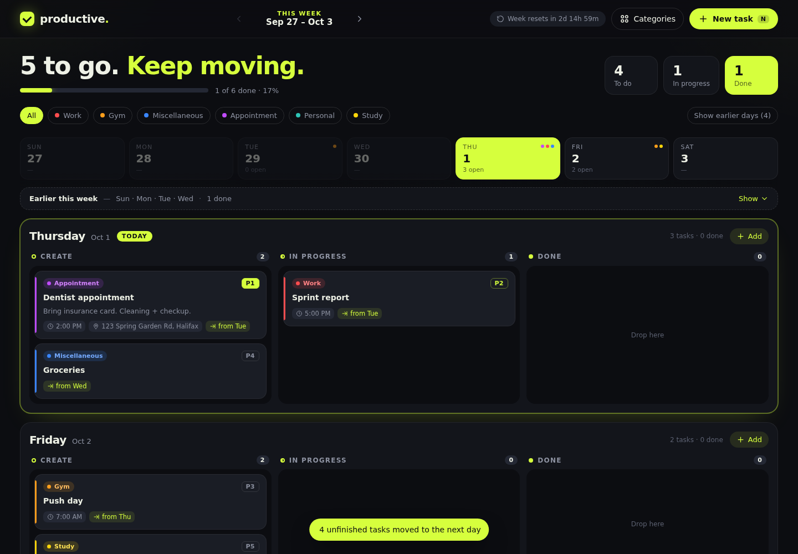
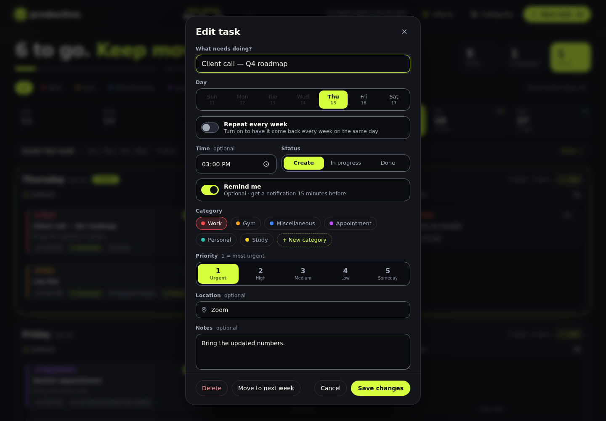
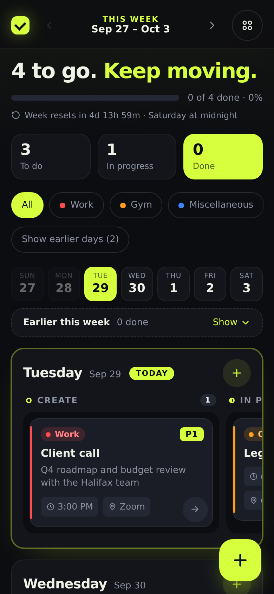

# productive. — Weekly Planner

A smooth, week-by-week task planner built with plain HTML, CSS and JavaScript. Each week starts as a fresh, empty page. You plan what you want to finish that week, move tasks through **Create → In progress → Done**, and at Saturday midnight the week resets for a clean start.

**No account. No setup. Just open it and plan.** Tasks save in your browser, reset every week, and nothing is ever sent to a server.



**Live:** [productiveplanner.online](https://productiveplanner.online)

## At a glance

| | |
|---|---|
| **What** | A weekly task planner that runs entirely in the browser: no account, no server, works offline and installs to a phone's home screen. |
| **Stack** | Plain HTML, CSS and JavaScript with no frameworks or dependencies. Service worker for offline use, Notifications API for reminders, GitHub Pages hosting with a custom domain. |
| **Security** | Strict Content Security Policy with outside connections blocked, all user text escaped, every saved or restored record re-validated on load, and limits against flooding. An automated suite of 31 attack checks covers script injection, tampered storage, crafted URLs and framing. See [Security](#security). |
| **Quality** | Automated Playwright tests, WCAG 2.1 AA color contrast on every page, keyboard navigation, and checks at desktop, iPhone and small Android widths. |
| **How it was built** | Built with Claude Code as a coding assistant. I set the requirements, reviewed every change, and wrote and ran the tests. |

---

## Table of contents
- [At a glance](#at-a-glance)
- [Features](#features)
- [Getting started](#getting-started)
- [How it works](#how-it-works)
  - [The weekly cycle](#the-weekly-cycle)
  - [Days and columns](#days-and-columns)
  - [Overdue tasks auto-shift](#overdue-tasks-auto-shift)
  - [Saving your data](#saving-your-data)
- [Using the app](#using-the-app)
  - [Creating a task](#creating-a-task)
  - [Moving tasks](#moving-tasks)
  - [Editing and deleting](#editing-and-deleting)
  - [Categories and colors](#categories-and-colors)
  - [Priority levels](#priority-levels)
  - [Filters and navigation](#filters-and-navigation)
  - [Keyboard shortcuts](#keyboard-shortcuts)
- [Reminders](#reminders)
- [Repeating tasks](#repeating-tasks)
- [The end-of-week flow](#the-end-of-week-flow)
- [Your data, offline & sharing](#your-data-offline--sharing)
- [Using it on your phone](#using-it-on-your-phone)
- [Why there's no sign-in](#why-theres-no-sign-in)
- [Pages](#pages)
- [Contact form](#contact-form)
- [Error handling](#error-handling)
- [Security](#security)
- [Accessibility & color contrast](#accessibility--color-contrast)
- [Design](#design)
- [Project structure](#project-structure)
- [Technical details](#technical-details)
- [Browser support](#browser-support)
- [Limitations](#limitations)
- [Ideas for future versions](#ideas-for-future-versions)

---

## Features

| | |
|---|---|
| 🗓️ **Weekly pages** | Each week (Sunday → Saturday) is its own page. You can see the current week and any week ahead, but never the past. |
| 📋 **3 columns per day** | Every day has **Create**, **In progress** and **Done** columns. |
| 🎨 **Your own categories** | Starts with Work, Gym, Miscellaneous, Appointment, Personal and Study. Add your own with any name and color straight from the filter row (**+ New category**) or the task window. |
| 🔢 **Priority 1–5** | 1 is most urgent. Cards sort automatically by priority, then by time. |
| 📝 **Task details** | Optional time, location (opens in Google Maps) and notes on every task. |
| ↪️ **Auto-shift** | Unfinished tasks whose time has passed move to the next day at the same time, until the end of the week. |
| 🔔 **Reminders (optional)** | A *Remind me* switch on any task with a time: one notification 15 minutes before, plus a small in-app pop-up. Off by default. |
| 🔁 **Repeat every week** | Turn on *Repeat every week* for routines (gym, meetings) and they come back every new week automatically. |
| 🌅 **End-of-week flow** | On Saturday, a notice offers to move unfinished tasks to next week. On Sunday, a "week in review" card shows how last week went. |
| 💾 **Persistent** | Data survives reloads and browser restarts for the whole week. |
| 🔄 **Weekly reset** | At Saturday midnight the finished week is cleared and the new week starts empty. |
| 🖱️ **Drag & drop** | Drag cards between columns and days, with a mouse or by press-and-hold on touch screens. |
| 🗂️ **Your data** | Download a backup, restore it on another device, or erase everything, from the **Your data** link in the footer. |
| 📴 **Works offline** | After the first visit, the bookmarked or home-screen app opens without internet. |
| 📱 **Mobile friendly** | Swipeable columns, bottom-sheet forms, a floating + button, big tap targets, and it installs to the home screen like an app. |
| 🙌 **No account, no setup** | No sign-up or password. Bookmark it or keep it open in a tab. |
| ❓ **How-to guide** | A full [how-to page](help.html) with a quick start, FAQ and troubleshooting, one click away from everywhere. |
| ✉️ **Contact form** | A [contact page](contact.html) that opens the visitor's email app (or Gmail / Outlook / Yahoo Mail) with the message ready to send. |
| 🛟 **Friendly error page** | Missing pages and unexpected errors show a clear page that says tasks are safe, with one-tap problem reporting. |
| 🔒 **Privacy & Terms** | Plain-language [Privacy Policy](privacy.html) and [Terms of Use](terms.html). |
| 🛡️ **Hardened** | Strict security policy, all saved data checked on load, limits against flooding, and anti-framing. |
| 🖨️ **Print-friendly** | Printing gives a clean black-and-white copy of the week. |
| ⚡ **No build step** | No frameworks, no dependencies, no install. |

---

## Getting started

### Option 1 — Visual Studio Code with Live Server (recommended)
1. Clone or download this repository.
2. Open the folder in **Visual Studio Code**.
3. Install the **Live Server** extension (Extensions panel → search "Live Server" by Ritwick Dey).
4. Right-click `index.html` → **Open with Live Server**.
5. After you save a change, **refresh the page yourself** (⌘/Ctrl + Shift + R). Live Server's auto-reload injects a script, which the app's security policy correctly blocks. Everything else works normally.

### Option 2 — Open the file directly
Double-click `index.html` to open it in any modern browser. (Offline support, notifications and home-screen install need a web address, so use Option 1 or 3 to try those.)

### Option 3 — Host it free on GitHub Pages (to use it on your phone)
1. Push this folder to a GitHub repository.
2. In the repository, go to **Settings → Pages**.
3. Under **Build and deployment**, choose **Deploy from a branch**, pick `main` and `/ (root)`, and click **Save**.
4. Tick **Enforce HTTPS** on the same page.
5. After a minute, the app is live at `https://<your-username>.github.io/<repo-name>/` (this project assumes `https://ms801525.github.io/Productive/`).
6. Open that link on your phone and add it to your home screen (see [Using it on your phone](#using-it-on-your-phone)).

### Option 4 — Any static server
```bash
# Python
python3 -m http.server 8000
# then visit http://localhost:8000

# Node
npx serve .
```

---

## How it works

### The weekly cycle
- A week runs from **Sunday 00:00** to **Saturday 23:59**, in the device's own time zone.
- The app opens on **this week**. Use the arrows at the top to look at **next week** and beyond (up to 52 weeks ahead). The "previous week" arrow is disabled on the current week, so past weeks can never be viewed.
- At **Saturday midnight**:
  - The week that just ended is **permanently deleted**. Only a numbers-only summary is kept for the [week in review](#the-end-of-week-flow).
  - The new week becomes "This week".
  - Tasks you had already planned for that new week are **kept**.
- A countdown in the top bar ("Week resets in 2d 14h 59m") shows how long is left.
- The reset happens even if the tab stays open overnight (a timer fires at midnight), and also when you open the app after being away.

### Days and columns
Each of the 7 days has three columns:

| Column | Meaning |
|---|---|
| **Create** | Planned, not started yet |
| **In progress** | Currently working on it |
| **Done** | Finished (the title is crossed out) |

- **Today** is highlighted with a lime outline and a "Today" label.
- **Days already past** in the current week fold into one "Earlier this week" bar so the board stays focused on what's left. Click **Show** (or "Show earlier days") to expand them. New tasks can't be added to past days.
- Each day header shows how many tasks it has and how many are done.
- The **day strip** gives a quick overview of the week (open tasks per day and colored category dots). Click a day to jump to it.

### Overdue tasks auto-shift
If a task isn't finished by its time, it moves **to the next day at the same time**. This repeats every day until **Saturday**.

**Rules**
- Only tasks in **Create** or **In progress** shift. **Done** tasks never move.
- A task **with a time** is overdue once that time passes (e.g. Tuesday 2:00 PM).
- A task **without a time** is overdue at the end of its day (midnight).
- If several days have passed, the task skips ahead to the first day where its time is still in the future.
- A shifted task shows a lime **"from Tue"** badge so you know where it started.
- On **Saturday** there's no next day, so an unfinished task stays there with a red **Overdue** badge. At midnight it's cleared with the rest of the week, unless you move it to next week.
- If you drag or edit a task onto a day yourself, the "from" badge resets.
- A short message says when tasks were moved (e.g. "4 unfinished tasks moved to the next day").

**Example**

| Task | Originally | You open the app on… | It moves to |
|---|---|---|---|
| Dentist appointment | Tue 2:00 PM | Thu 9:00 AM | Thu 2:00 PM (from Tue) |
| Groceries (no time) | Wed | Thu 9:00 AM | Thu (from Wed) |
| Push day | Thu 7:00 AM | Thu 9:00 AM | Fri 7:00 AM (from Thu) |
| Sprint report | Fri 5:00 PM | Sat 11:30 PM | Sat 5:00 PM, marked **Overdue** |

The app checks for overdue tasks when it loads, every 20 seconds while open, and whenever you switch back to the tab.

### Saving your data
- Everything saves **automatically** to the browser's `localStorage`. There's no save button.
- Reloading, closing the tab or restarting the browser keeps all your tasks for the week.
- If the app is open in **several tabs**, they stay in sync.
- Filters, "show earlier days" and dismissed notices are remembered too.
- If the browser blocks storage (some private windows) or it's full, one clear notice explains how to fix it, and the app keeps working in that tab.

---

## Using the app

### Creating a task
Click **New task** (or press **N**), the **+ Add** button on any day, **Add a task** inside an empty Create column, or the floating **+** on phones.



| Field | Required | Notes |
|---|---|---|
| **What needs doing?** | ✅ | The task title (up to 120 characters). |
| **Day** | ✅ | Sun–Sat of the week you're viewing. Past days of the current week are locked. |
| **Repeat every week** | Optional | Brings the task back every week on the same day. See [Repeating tasks](#repeating-tasks). |
| **Time** | Optional | Used for sorting, auto-shift and reminders. You can't pick a time that has already passed today. |
| **Status** | ✅ | Create, In progress or Done. Defaults to Create. |
| **Remind me** | Optional | Off by default. Available once a time is set. See [Reminders](#reminders). |
| **Category** | ✅ | Pick a category, or tap **+ New category** to make one on the spot (it's selected for this task). |
| **Priority** | ✅ | 1 (Urgent) to 5 (Someday). Defaults to 3. |
| **Location** | Optional | Great for appointments. On the card it becomes a link that opens Google Maps. |
| **Notes** | Optional | Details, links, things to bring (up to 2,000 characters). The first two lines show on the card. |

After you add a task, the board scrolls to that day and a confirmation appears.

**Reading a card:** category tag and priority badge at the top, then the title and notes. Below are small tags for time, **Reminder** (bell), location, **Weekly** (repeating), **from Tue** (auto-shifted) or **Overdue**.

### Moving tasks
- **Drag and drop** a card into another column, or onto another day.
- **On a phone or tablet:** press and hold a card for about a third of a second until it lifts, then drag. The page scrolls when you drag near the top or bottom, and a day's columns slide sideways near the left or right edge. A quick swipe still scrolls normally.
- Click the **arrow button** on a card (it appears on hover, and is always visible on touch screens) to move it forward:
  - Create → In progress (→)
  - In progress → Done (✓)
  - Done → back to Create (↺)
- Or open the task and change its **Status** or **Day**.
- **Move to next week** in the task window moves it to the same day next week.

### Editing and deleting
- Click (or press **Enter** on) any card to edit it.
- **Delete** in the edit window removes it. An **Undo** button appears for 6 seconds.

### Categories and colors
Make your own categories with any name and color:
- the **+ New category** chip at the end of the filter row (pinned as **+ New** on phones),
- **+ New category** in the task window, or
- the **Categories** window in the top bar.

The **Categories** window also lets you:
- **Recolor** a category: click its color swatch.
- **Rename** it: type in the name field.
- **Delete** one: click the trash icon. Its tasks move to *Miscellaneous* (or the first remaining category). At least one category must always exist.

Changes apply instantly to every card. Tag text color is worked out per color, so even very dark or very bright custom colors stay readable. Up to 30 categories.

Default categories:

| Category | Color |
|---|---|
| Work | 🔴 `#FF4D4F` |
| Gym | 🟠 `#FF9F1C` |
| Miscellaneous | 🔵 `#3A86FF` |
| Appointment | 🟣 `#C04CFD` |
| Personal | 🟢 `#2EC4B6` |
| Study | 🟡 `#FFD60A` |

### Priority levels

| Level | Label | Card badge |
|---|---|---|
| 1 | Urgent | Solid lime **P1** |
| 2 | High | Lime outline **P2** |
| 3 | Medium | Grey **P3** |
| 4 | Low | Grey **P4** |
| 5 | Someday | Grey **P5** |

Inside each column, tasks sort by **priority first**, then by **time** (earliest first; tasks without a time go last), then by when they were created.

### Filters and navigation
- **Category filters:** click one or more category chips to show only those tasks. Click **All** to clear.
- **Week arrows:** go forward to future weeks. The label shows "This week", "Next week" or "In 3 weeks".
- **Today button:** appears on a future week and jumps back to the current one.
- **Progress bar and stats:** show how much of the week is finished, and how many tasks are To do, In progress and Done.

### Keyboard shortcuts

| Key | Action |
|---|---|
| `N` | New task |
| `?` | Open the how-to page |
| `Shift` + `→` | Next week |
| `Shift` + `←` | Previous week (back to the current week) |
| `Enter` / `Space` | Open the focused card |
| `Esc` | Close a window |

---

## Reminders

Kept deliberately simple, and completely optional:
- A **Remind me** switch in the task window. It's **off by default** and only available when the task has a time.
- **15 minutes before** the task (`REMIND_MIN` in `app.js`), Productive shows a system notification and, if the app is on screen, a small **"Coming up"** pop-up in the corner. Tapping the notification brings Productive to the front.
- The first time someone turns it on, the browser asks to allow notifications. If they say no, reminders still appear as the in-app pop-up.
- Each reminder shows **once**. A reload or a second tab won't repeat it. Finished tasks never remind, and nothing pops up if the app is opened after the task's time.
- Repeating tasks keep their reminder every week. Cards with a reminder show a small bell **Reminder** tag.
- Reminders work **while Productive is open**: a tab, a pinned tab, or the home-screen app. With no server, there's nothing to send alerts when it's fully closed, which fits the "keep it open" approach.
- On **iPhone and iPad**, web notifications only work after the app is added to the Home Screen. Otherwise the in-app pop-up is used.

**How it works in code:** `checkReminders()` runs on every tick, and `scheduleNextReminder()` sets a timer for the next one so it fires on time. Before showing a reminder, the app saves `remindedFor` on the task (the reminder's timestamp), which is what prevents duplicates. Notifications go through the service worker (`reg.showNotification`) when available, otherwise `new Notification()`. The task title is always inserted as plain text.

## Repeating tasks

Turn on **Repeat every week** in the task window for routines like the gym or a weekly meeting.
- Every week from the current one onward gets one copy on that day, with a **Weekly** tag.
- **Edit** a copy with *Repeat every week* still on: the routine and its future copies are updated.
- **Delete** a copy: only that week is skipped (Undo brings it back).
- **Turn repeat off:** future copies are removed, and this week's task stays.
- If you were away, copies whose time has already passed this week aren't created, so they don't pile up as overdue.
- Up to 50 repeating tasks.

In code, routines are templates stored in `state.routines`. `ensureRoutines()` fills each week as it's shown, and copies are linked by `routineId`. Deleting a copy adds that week to the routine's `skip` list.

## The end-of-week flow

- **Move to next week** (task window) moves one task to the same day next week. If it was auto-shifted, it goes back to its original day.
- **Saturday notice:** on Saturday, a notice says how many unfinished tasks will be cleared at midnight, with one tap to move them all to next week. It can be dismissed for the week.
- **Week in review:** on the new week, a one-time card shows how many tasks were done last week and the most-finished category. Only these numbers are kept (`state.lastWeek`), never task content.

## Your data, offline & sharing

- **Your data** (footer link, or `index.html#data`):
  - **Download a backup** as a JSON file.
  - **Restore** a backup, for example on a new computer. Max 2 MB, checked with the same strict `sanitize()` as saved data, and finished weeks are skipped.
  - **Erase everything** with two taps.
  - Shows how much storage is in use.
- **Offline:** `sw.js` caches only the site's own files. It's *network-first*, so updates appear immediately when online and the saved copy is used offline. It never touches task data. Bump `CACHE` in `sw.js` if you add files.
- **Home-screen shortcuts:** long-press the installed app icon for **New task** (`index.html?new=1`) or **How to use**.
- **Link previews:** Open Graph and Twitter tags plus `icons/og-image.png` (1200×630) make shared links show a title, description and image. They point at `https://ms801525.github.io/Productive/`. Update them in each page's `<head>`, `robots.txt` and `sitemap.xml` if your address is different.
- **Search engines:** `robots.txt` and `sitemap.xml`. `.nojekyll` tells GitHub Pages to publish files as-is.
- **Print:** a print stylesheet gives a clean black-and-white copy of the week (buttons, notices and pop-ups are hidden).

---

## Using it on your phone



| On phones | What changes |
|---|---|
| **Header** | One row: logo, week switcher, How to (?) and Categories. Week dates shorten to "Oct 11 – 17". |
| **New task** | A floating lime **+** button in the bottom-right corner, in easy reach of your thumb. |
| **Columns** | Each day's Create, In progress and Done columns become a sideways swipe carousel. The next column peeks in so you know it's there. |
| **Forms** | Task, Categories and Your data windows slide up from the bottom. Text fields use 16px text so iPhones don't zoom in. |
| **Buttons** | At least 40–44px tall. The move-forward arrow on cards is always visible. |
| **Filters** | Category chips scroll sideways in one row, with **+ New** pinned at the end. |
| **Moving tasks** | Press and hold a card to drag it, or tap the arrow on the card. |
| **Reminders** | The "Coming up" pop-up spans the top of the screen. |
| **Reset countdown** | Shown under the progress bar. |
| **Notches** | Content stays clear of the notch, rounded corners and home indicator. |

### Add it to your home screen
The app has a web app manifest and icons, so it installs like a regular app (full screen, no browser bar):
- **iPhone (Safari):** open the site → tap **Share** → **Add to Home Screen**. This is also what enables reminder notifications on iPhone.
- **Android (Chrome):** open the site → tap the **⋮** menu → **Add to Home screen** or **Install app**.

This works when the app is served from a web address (such as GitHub Pages), not when opening the file directly.

> Tasks are stored per browser. Your phone and your laptop each keep their own planner. Use **Your data → Download a backup** and **Restore** to move tasks between them.

## Why there's no sign-in

**Productive deliberately has no accounts.** It's built to be as simple as possible:

- **No setup.** No sign-up, no password, no email. Open the page and start planning.
- **Saves automatically.** Tasks are stored in the browser, so they're still there after a reload or restart.
- **Resets every week.** Saturday at midnight the finished week clears, so there's never a backlog.
- **Private by default.** Nothing is sent to a server, so there's no personal data to protect, leak or sell.
- **Every user has their own planner.** Each visitor's tasks live only in their own browser. Nobody sees anyone else's page.

The trade-off is that each browser and device keeps its own planner. The app says so, and encourages people to **bookmark it or keep it open**:

- A **"No account · No setup — Just open it and plan."** section near the bottom of the planner explains the idea, with a bookmark tip that fits the device: <kbd>⌘</kbd>+<kbd>D</kbd> on Mac, <kbd>Ctrl</kbd>+<kbd>D</kbd> on Windows/Linux, *Add to Home Screen* on iPhone and Android, and a friendly note if it's already installed.
- The how-to page has **No account needed** and **Bookmark it or keep it open** sections, including how to pin the tab.
- The first-visit welcome banner says "No sign-up needed".

## Pages

| Page | File | What it's for |
|---|---|---|
| **Planner** | `index.html` | The app itself. |
| **How to use** | `help.html` | 18 short sections: quick start, reading a card, adding, moving, editing, reminders, repeating tasks, the weekly reset, overdue tasks, categories and priority, weeks and filters, phone tips, no account, bookmarking, your data / offline / print, shortcuts, FAQ and troubleshooting. Topic chips at the top jump to each section. |
| **Privacy Policy** | `privacy.html` | Explains that tasks stay on the device, exactly what's stored, reminders and the offline cache, the third-party services involved (GitHub Pages, Google Fonts, Google Maps, and email if someone makes contact), retention, export and erase, security, and Canadian privacy law (PIPEDA). |
| **Terms of Use** | `terms.html` | Usage rules, the weekly deletion, reminders and repeating tasks as conveniences (not guarantees), feedback, ownership, no warranty, limitation of liability, and Nova Scotia governing law. |
| **Contact** | `contact.html` | Contact form that emails alimustafa189@yahoo.com (see below). |
| **Error page** | `404.html` | Shown for missing pages and for app errors (see below). |

**The how-to page is easy to find:**
- **How to** button (a **?** on phones) in the planner's top bar, always visible.
- A **"New here?" welcome banner** with a *Read the how-to* button, shown until it's dismissed or the first task is added.
- **Footer links** on every page: How to use · Privacy · Terms · Contact (plus **Your data** on the planner).
- The **`?`** keyboard shortcut, and links from the error and 404 pages.

All pages share the app's look (`styles.css` plus `pages.css`), work on phones, and have a sticky top bar with a **Back to planner** button.

## Contact form

`contact.html` lets visitors reach the owner at **alimustafa189@yahoo.com** with a question, idea or problem.

- Fields: a topic (Question, Idea, Problem, Other), an optional name and reply email, and a message of up to 1,500 characters.
- **Send message** opens the visitor's email app with the subject (`[Productive] Idea: …`) and body filled in. They press Send.
- If no email app opens, one-click buttons open the same message in **Gmail**, **Outlook** or **Yahoo Mail** on the web, plus **Copy message**.
- For **Problem** reports, technical details (browser, screen, and the last app error) can be included with a checkbox. Never task content.
- The error page's **Report this problem** and the 404 page's **Report a broken link** open the form pre-filled.
- Nothing is stored or sent by the website itself, and no third-party form service is used.
- The address is assembled by JavaScript instead of being written in the HTML, to cut down on spam from address-harvesting bots.

**To change the address**, edit the `PRODUCTIVE_EMAIL` line in `pages.js`. Every page (including the contact form) reads it from there.

## Error handling

`404.html` has two modes:

| Mode | When | What the user sees |
|---|---|---|
| **Page not found** | Any address that doesn't exist (GitHub Pages serves `404.html` automatically) | "This page took the week off." Their tasks are safe, with buttons back to the planner and the how-to page. *Report a broken link* opens the contact form with the bad address filled in. |
| **App error** | `404.html?type=error`, where the app sends people if something breaks | "Something went wrong. I'm on it." Their tasks are safe, with **Try again**, **Report this problem** (contact form with the error details ready, never task content), **Download backup**, and a two-tap **Reset app** if it keeps failing. A *Technical details* section shows the error. |

How it works:
- A safety net at the top of `app.js` catches uncaught errors and failed promises from the app's own code, keeps the last 10 error details on the device (`productive.errors.v1`), and redirects to the error page. Errors from browser extensions and harmless cancelled animations are ignored.
- **Damaged data can't crash the app.** On load, `sanitize()` repairs or drops anything malformed before rendering.
- **Storage problems** (blocked or full) show a notice instead of an error page.
- `404.html` is fully self-contained (inline styles, links worked out at runtime), so it looks right even from a deep broken address like `/Productive/a/b/c`.

## Security

### What there is to protect
Productive is a **static website**: no server, no database, no accounts, no shared data. Each visitor's tasks live only in their own browser. That rules out most attacks by design:

| Concern | Why it isn't a risk here |
|---|---|
| Someone seeing other users' tasks | User data only exists in each person's own browser, and browsers never share it between websites or people. |
| Bots or fake users | There's nothing for a bot to do: no sign-up, no posting, no shared database, and the contact form can't send email by itself (a person has to press Send in their own email app). A CAPTCHA would only slow down real people. |
| Overloading / denial of service | Pages are static files served by GitHub Pages' global CDN, which absorbs heavy traffic. There's no backend to overload. |
| Stealing secrets | The repository contains no passwords, API keys or private data. The only personal detail is the public contact email, assembled by script to hide it from simple spam bots. |

### Protections built in
- **Content Security Policy** on every page: the browser only runs scripts from this site's own files, so injected or third-party code is blocked. It also forbids connections to any outside server (`connect-src 'none'`), so the app can't leak data even if something went wrong. No plugins, no frames, no `<base>` changes, no form submissions elsewhere. Only Google Fonts is allowed from outside.
- **No inline scripts.** Page scripts live in `app.js`, `pages.js` and `contact.js`. The one exception, `404.html`, is allowed by its SHA-256 hash (it has to stay self-contained).
- **All user text is escaped** before it's shown (titles, notes, locations, category names, reminder pop-ups), so typing HTML or code just shows it as text.
- **Saved data is strictly checked on load** (`sanitize()` in `app.js`): rebuilt from known fields only, IDs must match `[A-Za-z0-9_-]`, colors must be `#rrggbb`, times and dates must be valid, `remind` must be exactly `true`, lengths are clipped, duplicates and junk are dropped, and the cleaned data is saved back immediately. Restored backups go through the same check. Tampering with browser storage can't inject code or crash the app.
- **Limits** stop anyone flooding the app: 300 tasks per week, 30 categories, 50 repeating tasks, 60 weeks of saved data, 2 MB backups, and title 120 / location 160 / notes 2,000 / category name 30 characters, enforced in code as well as in the form.
- **Anti-framing (clickjacking):** if another website loads Productive inside a frame, the page clears itself and shows only an "Open Productive in its own tab" link.
- **No referrer leaks:** `referrer` is `no-referrer`, so sites like Google Maps or Gmail don't learn which page you came from.
- **Safe links:** links that open a new tab use `rel="noopener"`. Location links can only ever be a Google Maps search, so `javascript:` tricks are impossible.
- **Error page and contact form** treat error details and link parameters as plain text.

### Tested
An automated attack suite (31 checks) tries script injection through every input, tampered and oversized storage (`__proto__` keys, bad IDs, bad colors, garbage rows), crafted URLs, framing by another site, flooding a week, and loading scripts or sending data to an outside server. All are blocked, and the policy blocks nothing the app needs. The reminder tests also confirm that a task title containing HTML shows as plain text in the notification and pop-up, and that tampered reminder values are removed.

### Keeping it secure (owner checklist)
1. **Turn on two-factor authentication on your GitHub account.** Whoever controls the repo controls the website, so this matters most.
2. In the repo, go to **Settings → Pages** and tick **Enforce HTTPS**.
3. Never commit passwords or API keys. Nothing in this app needs any.
4. If you edit the `<script>` at the bottom of `404.html`, update its hash in that file's `Content-Security-Policy` line. The browser console shows the exact value it expects, or run:
   ```bash
   python3 -c "import re,hashlib,base64;s=open('404.html').read();print(base64.b64encode(hashlib.sha256(re.search(r'<script>(.*?)</script>',s,re.S).group(1).encode()).digest()).decode())"
   ```
5. **Developing with Live Server:** refresh by hand after each save (see [Getting started](#getting-started)).

## Accessibility & color contrast

All text meets **WCAG 2.1 AA** contrast (at least 4.5:1, or 3:1 for large text), checked with an automated audit of every page and window.
- `--muted` `#a4a9b8` and `--faint` `#8b90a0` pass on every background the app uses.
- Past days use dashed outlines instead of being faded, so their text stays readable.
- Category tag text is calculated per color (`catTextColor()` in `app.js`), so even dark custom colors stay readable.
- Form field outlines (`--field-line` `#6a7081`) have at least 3:1 contrast.
- Keyboard-navigable cards and windows, visible focus rings, ARIA labels, and the system "reduce motion" setting turns animations off.

## Design
- **Two-color scheme:** deep ink (`#0C0D11`) and electric lime (`#D6FF3D`). Category colors appear only as small tags and card accents.
- **Typography:** [Space Grotesk](https://fonts.google.com/specimen/Space+Grotesk) for headings and [Inter](https://fonts.google.com/specimen/Inter) for body text, with system fonts as a fallback offline.
- **Smoothness:** cards glide to their new spot when moved (View Transitions API), pop in when created and lift on hover. Windows slide in with a soft spring, and a blurred, sticky top bar keeps controls in reach.
- **Responsive:** tested at desktop (1366–1440px), iPhone (390px) and small Android (360px) sizes, with no sideways page scrolling at any size.

---

## Project structure

```
Productive/
├── index.html            # The planner: layout, task / categories / your-data windows
├── app.js                # All app logic (weeks, storage, auto-shift, drag & drop,
│                         #   reminders, repeating tasks, notices, security checks)
├── styles.css            # Theme, layout, animations, responsive and print rules
├── help.html             # How-to guide
├── privacy.html          # Privacy Policy
├── terms.html            # Terms of Use
├── contact.html          # Contact form (opens the visitor's email app)
├── contact.js            # Contact form logic
├── 404.html              # Page-not-found + app error page (self-contained)
├── pages.css             # Extra styles for the how-to, privacy, terms and contact pages
├── pages.js              # Shared script for those pages (contact email, anti-framing)
├── sw.js                 # Offline support + notification taps (service worker)
├── manifest.webmanifest  # Home-screen install, app shortcuts
├── robots.txt            # Search engines
├── sitemap.xml           # Search engines
├── .nojekyll             # Tells GitHub Pages to publish files as-is
├── icons/
│   ├── icon.svg              # Browser tab icon
│   ├── icon-192.png          # Android home-screen icon
│   ├── icon-512.png          # Android splash / large icon
│   ├── apple-touch-icon.png  # iPhone home-screen icon
│   └── og-image.png          # Link preview image (1200×630)
├── docs/
│   ├── screenshot-desktop.png
│   ├── screenshot-mobile.png
│   └── screenshot-task.png
└── README.md
```

---

## Technical details

**Stack:** vanilla HTML5, CSS3 and JavaScript (ES2020). No dependencies, no build tools.

**Drag & drop:** mouse and trackpad use the browser's built-in HTML5 drag and drop. Touch devices use a custom press-and-hold drag built on touch events, because mobile browsers don't support HTML5 drag and drop reliably.

**Storage keys** (`localStorage`):

| Key | Contents |
|---|---|
| `productive.v1` | Categories, the active week, tasks grouped by week, repeating tasks (`routines`) and last week's summary (`lastWeek`) |
| `productive.ui.v1` | UI preferences: active filters, show earlier days, welcome dismissed, week review seen, Saturday notice dismissed |
| `productive.errors.v1` | The last 10 app errors, used only by the error page's report button |

**Data shape**
```json
{
  "version": 1,
  "activeWeek": "2026-10-11",
  "categories": [{ "id": "work", "name": "Work", "color": "#FF4D4F" }],
  "weeks": {
    "2026-10-11": [
      {
        "id": "tmg4k2x9ab12",
        "title": "Dentist appointment",
        "day": 2,
        "time": "14:00",
        "status": "create",
        "cat": "appointment",
        "priority": 1,
        "location": "123 Spring Garden Rd, Halifax",
        "notes": "Bring insurance card.",
        "createdAt": 1790000000000,
        "originalDay": 1,
        "remind": true,
        "remindedFor": 1791997200000,
        "routineId": "r8k2m1"
      }
    ]
  },
  "routines": [
    {
      "id": "r8k2m1", "title": "Leg day", "day": 4, "time": "18:00",
      "cat": "gym", "priority": 2, "location": "", "notes": "",
      "since": "2026-10-11", "skip": [], "remind": true
    }
  ],
  "lastWeek": { "week": "2026-10-04", "total": 10, "done": 7, "top": "Work" }
}
```
- Weeks are keyed by the date of their **Sunday** (`YYYY-MM-DD`, local time).
- `day` is `0` (Sunday) to `6` (Saturday). `status` is `create`, `progress` or `done`.
- Optional fields appear only when used: `originalDay` (auto-shifted), `remind` and `remindedFor` (reminders), `routineId` (copy of a repeating task).

**Main pieces of `app.js`**
- **Safety net and anti-framing** at the top of the file.
- `sanitize()` checks and repairs all saved or restored data.
- `checkRollover()` deletes past weeks at the new week and records the `lastWeek` summary.
- `ensureRoutines()` adds repeating-task copies to each week.
- `shiftOverdue()` applies the auto-shift rules to the current week.
- `render()` rebuilds the header, notices, filters, day strip and board from state.
- `update()` changes the data, saves it and re-renders with a smooth view transition.
- `moveToNextWeek()` handles the task-window button and the Saturday notice.
- `checkReminders()` / `scheduleNextReminder()` / `showReminder()` handle reminders.
- The touch-drag section handles press-and-hold dragging on phones and tablets.
- `tick()` runs every 20 seconds, on tab focus, and exactly at Saturday midnight to handle resets, shifts, reminders and the countdown.

All dates use the device's local time zone.

---

## Browser support
Works in current versions of **Chrome, Edge, Firefox and Safari** (desktop and mobile).
- Animated card moves use the View Transitions API. Browsers without it still work, just without that animation.
- Notifications work in desktop browsers and on Android. On iPhone/iPad (iOS 16.4+), they need the app on the Home Screen. Everywhere else, the in-app pop-up is used.
- Mobile: iOS Safari 15+ and Chrome for Android. Touch drag, bottom sheets and home-screen install are supported.

---

## Limitations
- By design there are no accounts, so data lives in **one browser on one device**, and clearing browser data erases it.
- Past weeks are deleted by design. Only last week's numbers are kept, for the review card.
- Reminders only work while Productive is open (no server means no push notifications when it's closed).
- Moving data between devices is manual (download a backup, then restore it on the other device).

## Ideas for future versions
- Light theme toggle
- Monday-start weeks as an option
- Share a week by link (encoded in the URL, still no server)

---

Built by Mustafa Ali.
